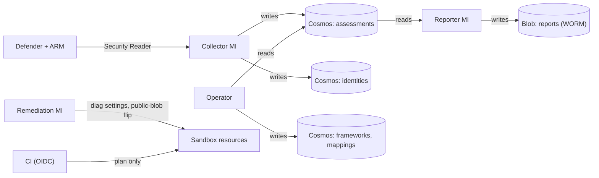

# CGE-AZ Pipeline Architecture

How this pipeline is put together: the stage flow, the contracts between stages,
where data goes, and which identity is allowed to touch what. It extends the course
starter's architecture doc. Where this build departs from the starter, the text says
so and names the pull request; section 5 lists every departure and why.

## 1. Stage flow

```
            ┌──────────────┐    ┌──────────────┐    ┌──────────────────┐
  Lab 1-3   │ 01 foundation│───▶│ 02 activation│    │ 03 evidence store│
            │ MG hierarchy │    │ discover gap │    │ Cosmos + WORM    │
            │ policies     │    │ enable plans │    │ blob + collector │
            │ remediation  │    │ CSF 2.0 std  │    └────────┬─────────┘
            │ identity     │    └──────────────┘             │
            └──────┬───────┘                                 ▼
                   │                                ┌──────────────────┐
                   │                                │ 04 reporting     │
                   │                                │ POA&M + SAR from │
                   │                                │ the store ONLY   │
                   ▼                                └────────┬─────────┘
            ┌──────────────┐                                 ▼
            │ 06 enforce   │                        ┌──────────────────┐
            │ Modify effect│                        │ 05 narrative     │
            │ audit→dry-run│                        │ (optional) AI    │
            │ →enforce     │                        │ digest of 04     │
            └──────────────┘                        └──────────────────┘
```

Each stage is a Terraform root module with its own state file in the shared
`tfstate` container (bootstrapped once by `labs/03-foundation/bootstrap.sh`, the one
piece that cannot manage itself). Stages are applied in number order and destroyed in
reverse. Stage 05 is a lab, not a stage directory: it reads stage 04's artifacts and
produces prose; it never decides anything.

### The contract between stages

Downstream stages read upstream **outputs** through `terraform_remote_state`. Outputs
are the interface; everything else is private implementation.

| Stage | Reads from | Publishes |
|---|---|---|
| 01 foundation | nothing | `subscription_id`, `management_group_id`, `log_analytics_workspace_id`, `evidence_resource_group_name`, `remediation_identity_id`, `remediation_identity_principal_id` |
| 02 activation | nothing (discovers live state with `azapi` data sources) | Defender plan tiers, the NIST CSF 2.0 assignment |
| 03 evidence store | 01 | `cosmos_endpoint`, `cosmos_account_id/name`, `evidence_storage_account`, `reports_container`, `collector_function_app`, `collector_principal_id` |
| 04 reporting | 01, 03 | `reporting_function_app`, `reporter_principal_id` |
| 06 enforcement | 01 | `remediation_mode` |

Stage 01 adopts the Lab 1–2 resources (management groups, sandbox resource group,
Log Analytics workspace) with `terraform import` rather than recreating them. Stage 02
is discovery-first: `azapi` data sources read every Defender plan's current tier and
activation converges only the measured gap; a plan already at Standard stays
untouched and becomes change-managed.

## 2. Data flow

```
 Defender for Cloud ──(assessments API)──▶ collector Function ──▶ Cosmos: assessments
                                           daily 05:00 UTC          /subscriptionId
                                           + resourceGroup, owner
 ARM role assignments ─────────────────▶ collector Function ──▶ Cosmos: identities
                                           daily 05:10 UTC          /subscriptionId
 Azure Policy ──────────────────────────▶ compliance states (portal / KQL; not collected)

                 frameworks ◀── seed_frameworks.py (CSF 2.0 catalog)
                 mappings   ◀── the crosswalk, as data

 Cosmos: assessments ──(latest runId)──▶ reporting Function ──▶ WORM `reports` container
                                         POA&M daily 06:00 UTC (xlsx + json)
                                         SAR weekly, Mondays 07:00 UTC (md)

 Both Function Apps ──▶ Application Insights (workspace-based, managed-identity auth)
```

The starter's optional stage 05 (an AI narrative over the reports) was not built.

Three rules make this defensible:

- **Collect once.** One assessment document serves every framework through the
  `mappings` crosswalk. Adding a framework is a data change, not a collector change.
- **Reports read from the store only.** No report touches a live API. Every number is
  reproducible tomorrow with a stored query against a pinned `runId`.
- **Immutability is a platform guarantee, not an access rule.** The `reports`
  container carries a time-based immutability policy. Unlocked for the course so
  teardown works; production locks it.

### What the collectors add beyond the starter

- **Role assignments** (PR #7): a second timer in the same collector app writes one
  document per role assignment (principal ID and type, role, scope, scope level, a
  `privileged` flag, `runId`, `collectedAt`) to `identities`. It needs no new ARM
  role: Security Reader already includes `Microsoft.Authorization/*/read`.
- **Owners on every finding** (PRs #17, #18): each assessment carries its
  `resourceGroup` and that group's `owner` tag, read once per run. Subscription-level
  findings take `SUBSCRIPTION_OWNER`, set by Terraform from `OWNER_EMAIL`, because
  the collector deliberately cannot read subscription tags. A group with no owner
  tag shows `UNASSIGNED (no owner tag)` in the POA&M rather than a guessed owner.

### Current state, not history

Cosmos holds one document per finding and one per role assignment, overwritten
(upserted) on every run and never deleted. Three consequences:

- **Stale documents.** A torn-down resource or removed role assignment leaves its
  last document behind with an older `runId`. Reports select the latest run
  (`_latest_run`, then filter on its `runId`), so stale documents never reach the
  POA&M or SAR; ad-hoc queries must do the same. Seen live on Nov 8: 16 identity
  documents, 15 in the latest run, 1 left from a role assignment PR #13 replaced.
- **A partial run would undercount.** If a collector run stopped midway, it would
  still be the latest `runId`, and the next report would miss what it never wrote.
  Nothing marks a run complete today; App Insights (PR #16) records each run, so a
  failure is visible, not silent.
- **History lives in the reports.** A finding that fails and recovers between two
  daily reports leaves no trace in Cosmos. The dated, immutable POA&M and SAR files
  are the record over time; a history container or change feed would close this.

### Partition keys, justified

| Container | Partition key | Why |
|---|---|---|
| `assessments` | `/subscriptionId` | Every query the reports run is "this subscription, this run". A second and third subscription land as new partitions with no reshaping — the scale-by-scope requirement in the capstone brief. |
| `identities` | `/subscriptionId` | Same access pattern as `assessments`: one subscription, one run. |
| `frameworks` | `/frameworkId` | A catalog is read whole, one framework at a time. |
| `mappings` | `/frameworkId` | The crosswalk is queried per target framework when a report resolves which controls an assessment satisfies. |

Document IDs in `assessments` are a hash of `assessmentId|resourceId`, and in
`identities` are deterministic per role assignment, so a re-run upserts rather than
duplicates; lineage comes from `runId` and `collectedAt` on every document.

## 3. Identity boundaries

No stored credentials in the evidence path. Every actor is a managed identity or an
OIDC federation, and every identity's roles are a whitelist of its job. The one
exception is the Y1 runtime's own `func_internal` storage accounts, which require
shared keys; they hold no evidence (see "Documented gaps" below).

| Identity | Kind | Roles (scope) | Can | Cannot |
|---|---|---|---|---|
| **Deployer** (operator) | `az login` user | Owner on the subscription, `mg-grc` and `mg-grc-sandbox`; Storage Blob Data Contributor on the evidence account; Cosmos Data Reader on the account, Data Contributor on `frameworks` and `mappings` only | Apply stages, seed reference data, prove WORM, read all evidence | Write `assessments` or `identities`: only the collector writes evidence |
| **Remediation** `id-grc-remediation-<env>` | User-assigned MI | Monitoring Contributor (`mg-grc-sandbox`); custom `cge-remediation-storage-writer` (`mg-grc-sandbox`): `storageAccounts/read`, `storageAccounts/write`, `resourceGroups/read`, *only* when `remediation_mode != audit` (the sandbox runs `dry-run`) | Create diagnostic settings; flip `allowBlobPublicAccess` | Delete resources, list storage keys, read data |
| **Collector** `func-grc-collectors-*` | System-assigned MI | Security Reader (subscription); Cosmos Data Contributor on `assessments` and `identities` only; Monitoring Metrics Publisher on its own App Insights | Read Defender assessments, role assignments and resource-group tags; write evidence | Change posture; read subscription tags; read directory names (no Graph); write reports |
| **Reporter** `func-grc-reporting-*` | System-assigned MI | Cosmos Data Reader on `assessments` only; Storage Blob Data Contributor on the `reports` container only; Monitoring Metrics Publisher on its own App Insights | Read evidence; write immutable reports | Read live platform data; write evidence; write anywhere else in the evidence account |
| **CI** (your fork's gate + drift) | GitHub OIDC federation, fork-scoped (name-based and numeric-ID subjects) | Custom `cge-ci-planner` at `mg-grc`: `*/read` plus the list actions `terraform plan` needs; Storage Blob Data Contributor on the state resource group | `terraform plan`, conftest, open drift issues | Write resources or RBAC; hold a secret: there is none |



The boundaries that matter:

- **Recorder ≠ narrator.** The collector writes evidence and cannot read reports; the
  reporter reads one container and writes one container, and cannot touch live
  services. Each grant is scoped to a container, not the account (PR #13), so
  separation of duties is enforced by role scopes, not by policy text.
- **Only the collector writes evidence.** The operator's Cosmos access is read-only
  except for the two reference-data containers the seed scripts write (PR #13). No
  human can edit an assessment or identity record.
- **One named author for every automated change.** Filter the Activity Log by the
  remediation identity's principal ID and you have the complete history of what
  automation did. Its custom role (PR #3) replaces Storage Account Contributor,
  which also allowed delete and `listKeys`.
- **Plan-only CI, but not secret-blind.** `cge-ci-planner` (PR #4) replaced
  Contributor. It cannot write resources or RBAC, but the list actions plan needs to
  refresh state return storage, Cosmos and Log Analytics keys and Function App
  settings. Only the fork's OIDC subjects can use it.
- **Control plane ≠ data plane.** Owner does not read a blob or a Cosmos document;
  every reader holds an explicit data-plane role. The evidence account disables
  shared keys, Cosmos and App Insights disable local auth, and both Function Apps
  have FTP and SCM basic-auth publishing off (PR #14), so there is no key- or
  password-shaped way around this.
- **Upstream is unarmed.** This repo's workflows skip until `AZURE_CLIENT_ID` is set.
  Each learner federates their own fork against their own subscription
  (`labs/06-loop/arm-your-fork.sh`); a public upstream must never hold a path to a
  subscription, because `pull_request` OIDC subjects match PRs from any fork.

Documented gaps:

- **Operator holds Owner** at the subscription, `mg-grc` and `mg-grc-sandbox`, and the
  role-assignment collector reports it as privileged. This is a single-operator
  personal sandbox; production would use PIM with just-in-time elevation.
- **Operator keeps Storage Blob Data Contributor** on the evidence account to verify
  WORM and upload seeds. With WORM unlocked for teardown, that grant could write or
  delete report blobs; production locks WORM and gives humans Storage Blob Data Reader.
- **`func_internal` shared keys:** the Y1 Consumption runtime requires them. These
  accounts hold function code and runtime state only, never evidence.

## 4. The two loops

**The pipeline on the environment.** Policy assignments at the sandbox management
group inherit to every current and future subscription. Effects are deliberate:
Audit for the tag rule (onboarding), Deny for public blob (earned), DeployIfNotExists
for diagnostics (logging that enforces its own coverage). Stage 06 adds a Modify
effect on an escalation ladder wired to one variable — `audit` → `dry-run` → `enforce`
— where each step up is a reviewed one-line diff and dry-run keeps a human at the
remediation-task approval.

**The pipeline on itself.** The compliance gate (`.github/workflows/gate.yml`) runs
`terraform plan` per stage on every PR and refuses plans that break the repo's own
standard (`policy/*.rego`: no public blob, no shared keys, no broad roles). Drift
detection (`drift.yml`) plans nightly with `-detailed-exitcode` and opens an issue
when reality has moved away from code; the KQL tripwire in Log Analytics answers the
other direction — who has been touching reality.

## 5. Where this starter stops and yours begins

The rubric grades the pipeline, not the estate (`seed-estate.sh` gives you material
to find). At minimum your fork must add one policy or control of your own, correctly
effected and mapped in `CONTROLS.md`, and this document should gain a section for it:
what it checks, which identity acts, what its blast radius is, and why you chose its
effect. Good candidates the seeded estate leaves lying around: management ports open
to the internet, Key Vaults without purge protection, workload identities holding
Contributor, resources missing an owner tag.
